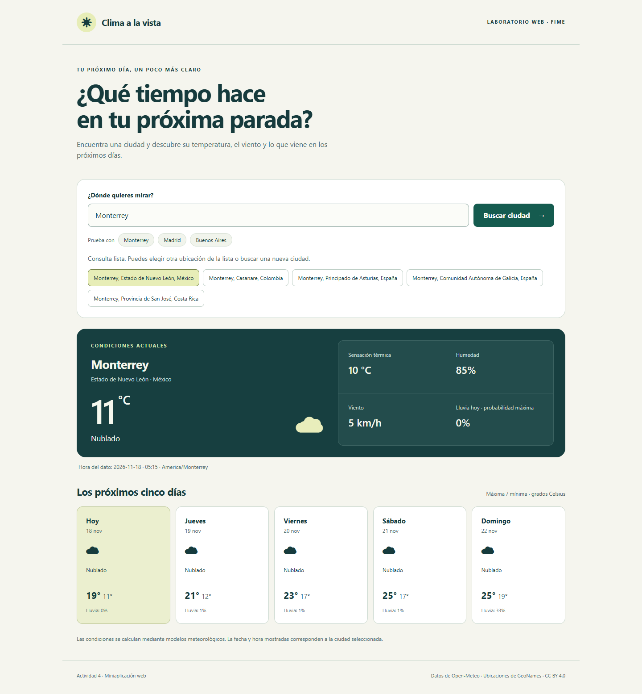
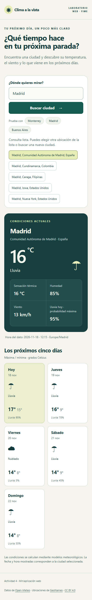
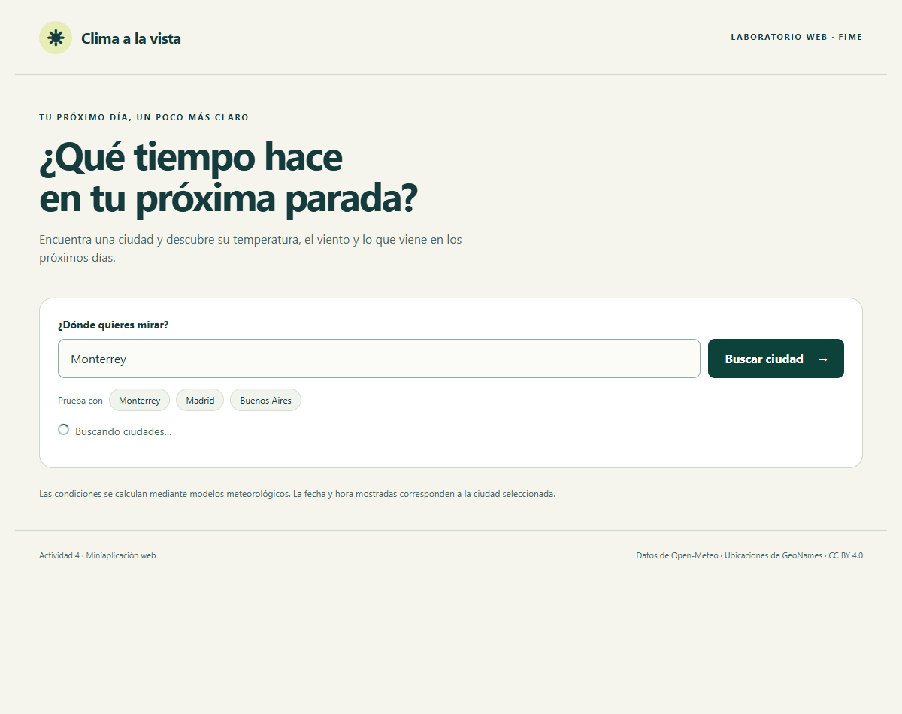
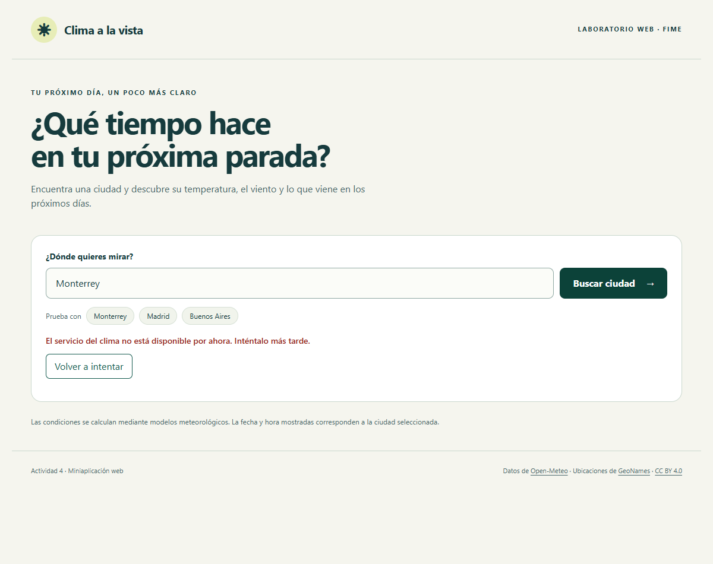

# Clima a la vista

Miniaplicación de la Actividad 4 del Laboratorio de Programación Web. Permite buscar una ciudad, elegir entre ubicaciones con el mismo nombre y consultar las condiciones actuales y cinco días de pronóstico. Los datos se obtienen de Open-Meteo mediante peticiones reales desde el navegador.

- **Aplicación:** https://code0167.github.io/clima-fime-api/
- **Repositorio:** https://github.com/code0167/clima-fime-api
- **Autor:** Angel Martinez.
- **Tecnologías:** HTML5, CSS3, JavaScript, Fetch API, async/await y GitHub Pages.

## Uso

1. Abre la aplicación con conexión a Internet. Se consulta Monterrey al iniciar.
2. Escribe al menos dos letras y pulsa **Buscar ciudad**.
3. Elige la ubicación correcta en la lista de coincidencias.
4. Consulta temperatura, sensación térmica, humedad, viento y probabilidad máxima de lluvia del día.
5. Revisa las cinco tarjetas del pronóstico. Las fechas corresponden a la zona horaria de la ciudad.
6. Puedes probar las sugerencias Monterrey, Madrid y Buenos Aires. Si falla una consulta, pulsa **Volver a intentar**.

Para trabajar localmente, extrae el ZIP completo y abre `index.html` con Live Server en Visual Studio Code. También puede abrirse con doble clic si el navegador permite las consultas a la API desde archivos locales. No hay un proceso de compilación ni dependencias que instalar. Se necesita Internet para recibir datos nuevos.

## API y documentación

Se utilizan dos endpoints públicos de Open-Meteo. Esta práctica no necesita una clave de API, cuentas de usuario ni geolocalización del dispositivo.

### Búsqueda de ubicaciones

`GET https://geocoding-api.open-meteo.com/v1/search`

| Parámetro | Valor utilizado |
| --- | --- |
| `name` | Nombre escrito por el usuario |
| `count` | `5` coincidencias como máximo |
| `language` | `es` |
| `format` | `json` |

La respuesta JSON contiene `results`, una lista de ubicaciones con nombre, coordenadas y región. Cuando no hay coincidencias, la aplicación admite que `results` no aparezca. `URLSearchParams` codifica espacios y caracteres especiales.

### Condiciones y pronóstico

`GET https://api.open-meteo.com/v1/forecast`

| Parámetro | Valor utilizado |
| --- | --- |
| `latitude`, `longitude` | Coordenadas de la ciudad seleccionada |
| `current` | `temperature_2m,relative_humidity_2m,apparent_temperature,weather_code,wind_speed_10m` |
| `daily` | `temperature_2m_max,temperature_2m_min,precipitation_probability_max,weather_code` |
| `timezone` | `auto` |
| `forecast_days` | `5` |
| `temperature_unit` | `celsius` |
| `wind_speed_unit` | `kmh` |

La respuesta JSON contiene objetos `current` y `daily`. Los arreglos diarios se relacionan por índice con `daily.time`. La función `condicion()` convierte los códigos meteorológicos en textos en español; `numero()` redondea para mostrar los valores. Un valor ausente aparece como “No disponible”.

Referencias oficiales consultadas el 18 de noviembre de 2026:

- [API de ubicaciones](https://open-meteo.com/en/docs/geocoding-api).
- [API meteorológica y códigos WMO](https://open-meteo.com/en/docs).
- [Licencia de los datos](https://open-meteo.com/en/licence).

## Programación asíncrona y DOM

`buscarCiudad()` obtiene las coincidencias y crea sus botones. `cargarClima()` solicita los datos de la ubicación elegida. Ambas utilizan `obtenerJSON()`, que espera `fetch()` con `await`, comprueba `response.ok` y transforma la respuesta con `response.json()`.

`mostrarClima()` crea las condiciones y tarjetas del pronóstico con `document.createElement()` y `append()`. Los textos externos se insertan con `textContent`; no se interpretan como HTML. El sitio usa CSS Grid y media queries para reorganizar las tarjetas en pantallas pequeñas.

## Carga, resultado vacío y errores

| Situación | Respuesta de la aplicación |
| --- | --- |
| Consulta en curso | Mensaje de carga y señal visual |
| Sin coincidencias | Mensaje para probar otra escritura |
| HTTP 400 | Aviso de consulta no interpretable; documentado por la API |
| HTTP 429 | Mensaje para esperar antes de reintentar |
| HTTP 5xx | Servicio temporalmente no disponible |
| Otros códigos HTTP fallidos | Mensaje con el código recibido |
| Red desconectada o bloqueo de red | Indicación de revisar la conexión |
| Más de 15 segundos de espera | Cancelación y opción de reintento |
| JSON ilegible o pronóstico incompleto | Mensaje de respuesta inesperada |

Los códigos 429 y 5xx se manejan de forma preventiva y se probaron con respuestas simuladas; no se provocaron en el servicio real. `AbortController` cancela consultas anteriores y un número de revisión evita que una respuesta antigua reemplace una búsqueda nueva. Los mensajes usan `aria-live`; todos los controles tienen etiquetas y foco visible.

## Evidencia y comprobaciones

Se comprobó el consumo real de la API con Monterrey y Madrid, las cinco tarjetas y el diseño a 390 píxeles de ancho. Además se probaron respuestas vacías, HTTP 503, HTTP 429, desconexión, JSON inválido, datos incompletos, reintentos, carga, selección de otra ubicación, consulta corta, respuestas antiguas y valores nulos. No se detectaron excepciones JavaScript en esas pruebas.

Las capturas de carga, error y resultado vacío corresponden a pruebas controladas. Las de escritorio y móvil muestran respuestas reales; son evidencia de una consulta concreta y sus valores cambian con el tiempo.

## Git y publicación

El repositorio incluye commits descriptivos para la implementación y la documentación. GitHub Pages publica los archivos de la rama `main` desde la raíz. `.nojekyll` permite servir los archivos como contenido estático. Para actualizar el sitio, modifica los archivos, crea un commit y envíalo a la misma rama.

## Reflexión técnica

Una consulta asíncrona permite mantener disponible la interfaz mientras llega la respuesta. Sin embargo, esperar `fetch()` no basta: también hay que revisar el estado HTTP, comprobar el formato JSON y comunicar cuándo faltan datos. Separar la búsqueda de ubicaciones de la consulta del clima facilita reutilizar la función de peticiones y hace explícito de dónde salen las coordenadas.

La limitación principal es depender de un servicio externo: si no hay Internet o la API está fuera de servicio, no se inventan datos ni se presentan capturas como resultados actuales. Los errores permiten reintentar. Como mejora futura, una caché con fecha de consulta podría reducir peticiones repetidas; esta versión siempre consulta la API al buscar o seleccionar una ubicación.

## Créditos

Datos meteorológicos de [Open-Meteo](https://open-meteo.com/), ubicaciones basadas en [GeoNames](https://www.geonames.org/), bajo [CC BY 4.0](https://creativecommons.org/licenses/by/4.0/). La interfaz traduce las descripciones, redondea las cifras y reorganiza los datos. No implica respaldo de esos proveedores al proyecto.
